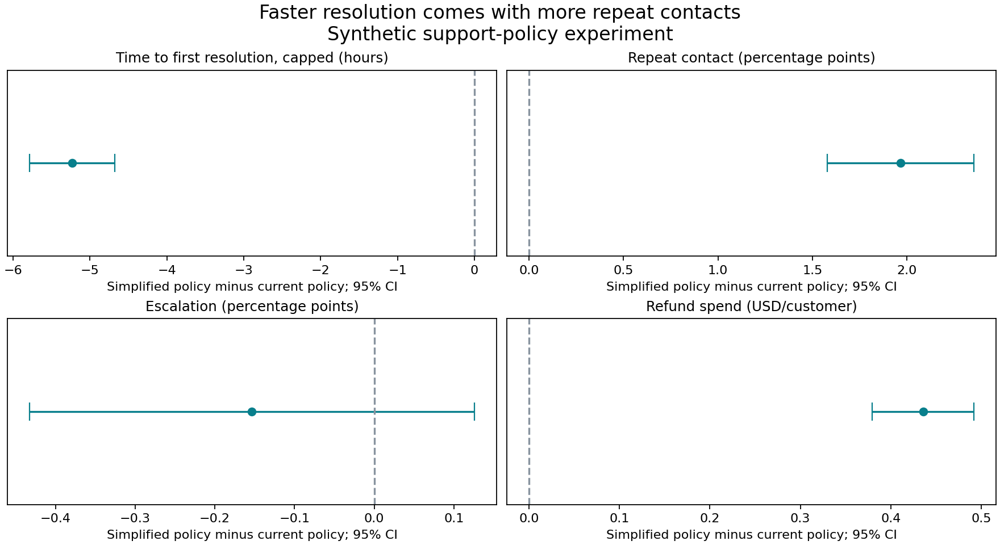

# Support Policy Impact Lab

**A faster refund process can still create more work.** This project tests that trade-off with a customer-randomised, synthetic support experiment. It asks whether shorter waiting times justify changes in repeat contacts, escalation and refund spend.

This is an independent portfolio project. It contains **no Uber data** and does not represent Uber's internal policies or systems. All reported results come from generated records.



## Start here

1. Read [the decision brief](outputs/decision_brief.md) for the business recommendation.
2. Open [the experiment plan](docs/experiment_design.md) to see how success was defined.
3. Run the app to explore estimates, uncertainty and cost assumptions.
4. Review `sql/` and the four executed notebooks for the analysis behind the decision.

The downloadable package includes generated data and outputs. The data can also be regenerated from the fixed seed. The default run analyses 100,000 customers. The recommendation is based on the observed output, not a hardcoded verdict.

## Run locally

Use Python 3.11 or 3.12; this package was tested with Python 3.12.14. Open a terminal **inside this project folder**.

```bash
python -m venv .venv
```

Activate it on Windows PowerShell:

```powershell
.venv\Scripts\Activate.ps1
```

Or on macOS / Linux:

```bash
source .venv/bin/activate
```

Then install and run:

```bash
python -m pip install -r requirements.txt
python -m pip install -e . --no-deps
python -m support_policy.pipeline
python -m pytest -q
python -m streamlit run app/app.py
```

Open the local URL printed by Streamlit (normally `http://localhost:8501`). No database account, API key or paid service is required. Internet access is needed to install dependencies; the pipeline itself runs offline.

If the machine has limited memory or CPU, set `POLARS_MAX_THREADS=4` and `OPENBLAS_NUM_THREADS=1` before running. DuckDB uses four threads. Run only one pipeline process at a time. The database is rebuilt from raw Parquet in a fresh temporary file, then replaces the previous generated database after a successful checkpoint.

## What the app contains

| Page | Question |
|---|---|
| Overview | What changed, and what is the recommendation? |
| Experiment Health | Did allocation, data quality and baseline balance look reasonable? |
| Policy Impact | Did the primary outcome and every guardrail pass? |
| Segment Explorer | Which groups deserve a closer look in a new experiment? |
| Rollout Scenarios | How do assumed volumes and repeat-contact costs change the trade-off? |

Rate effects are displayed as percentage points. The underlying CSVs store rates as fractions. Waiting-time effects are elapsed hours, not agent hours saved.

## Repository map

- `config/`: seeded simulation and analysis-plan choices.
- `data/raw/`: six generated source tables.
- `data/processed/`: DuckDB database and isolated simulation truth.
- `data/marts/`: customer-level experiment data and reporting extracts.
- `src/support_policy/`: reproducible generation, validation, modelling and reporting.
- `sql/`: five ordered SQL models; one-to-many relations aggregate before joining.
- `notebooks/`: executed EDA, power, effects and decision analysis.
- `app/`: Streamlit overview and four supporting pages.
- `tests/`: source integrity, time boundaries, join fanout, estimation and app tests.
- `docs/`: requirements, definitions, design choices and limitations.
- `outputs/`: estimates, figures, diagnostic reports and decision brief.

## Reproduce the notebooks

```bash
python scripts/execute_notebooks.py
```

If your environment blocks local Jupyter kernel connections, use `python scripts/execute_notebooks.py --in-process`. This executes the same cells with IPython and captures tables and plots without a kernel connection. The delivered notebooks use this mode.

Run the pipeline first. Notebook code reads generated data and recomputes selected calculations; it does not create a second competing pipeline. `scripts/create_notebooks.py` recreates the notebook sources and clears previous execution, so use it only when intentionally rebuilding them.

## Analytical choices

- Customer-level intention-to-treat comparison; follow original assignment.
- Seven-day capped time to first index-case resolution, including unresolved customers.
- Unadjusted difference in means with Welch intervals; baseline-adjusted HC3 OLS as sensitivity.
- Primary practical threshold plus simultaneous one-sided guardrail bounds.
- Predefined exploratory segments with multiplicity-adjusted q-values.
- Respondent-only satisfaction shown beside response rates, excluded from the rollout gate.
- Cost scenarios preserve covariance and do not monetise elapsed waiting time.

All configuration thresholds are illustrative choices made for this exercise. The plan hash is recorded with each run for traceability, but this is not an externally registered experiment.

## Publish on GitHub

Suggested repository name: `support-policy-impact-lab`.

Upload this folder's contents to your repository. Keep `README.md` at the repository root. The `.gitignore` excludes the reproducible raw data and database when using Git; executed notebooks, charts, code and findings remain reviewable. Do not upload your virtual environment or secrets. No GitHub repository has been created or published by this package.

For Streamlit hosting, use `app/app.py` as the entrypoint. The app needs `data/marts/experiment_mart.parquet` and the generated `outputs/` files. Include those explicitly in a deployment branch or run the pipeline during a suitable build process. A source-only upload will need that data preparation step.

## Validation and honesty

See `outputs/verification.md` for checks performed on the delivered build. Seeded simulation truth is compared with final estimates after the analysis, and a separate null simulation checks interval behaviour. This verifies implementation; it does not turn synthetic findings into evidence about a real support operation.

See [limitations](docs/limitations.md) before reusing the analysis. AI assisted the build; the code, assumptions and checks are available for review.
